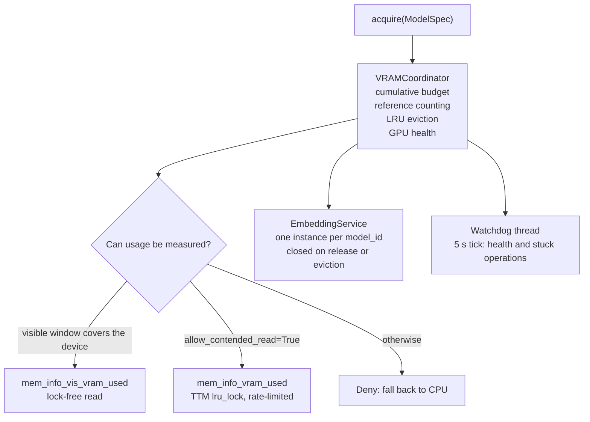

# vram-coordinator

**GPU memory reservations for concurrent local-LLM workloads on AMD hardware**

[](https://github.com/oscargzss/vram-coordinator/actions/workflows/ci.yml)
[](https://www.python.org/downloads/)
[](LICENSE)

`VRAMCoordinator` provides a single accounting point for GPU memory when several
workers or threads in one process load GGUF models at the same time. A caller asks
for a reservation before loading a model, receives either a grant or an instruction
to fall back to CPU, and shares one instance with other callers that request the
same model. A watchdog monitors the device and reports when it stops responding.

The module is pure Python with no runtime dependencies. It only reads sysfs
attributes; it never writes to them, and it does not disable the GPU or modify the
context size.

## Background

A host running four workers that each loaded the same GGUF embedding model with
`n_gpu_layers=-1` rebooted without a core dump. The kernel log recorded:

```
BUG: soft lockup - CPU#N stuck for 1717s!
```

The counter involved is `mem_info_vram_used`. In the kernel it is served by
`ttm_resource_manager_usage()`, which takes the TTM device `lru_lock` spinlock
(source: Linux v6.18, `drivers/gpu/drm/ttm/ttm_resource.c`):

```c
uint64_t ttm_resource_manager_usage(struct ttm_resource_manager *man)
{
	uint64_t usage;

	spin_lock(&man->bdev->lru_lock);
	usage = man->usage;
	spin_unlock(&man->bdev->lru_lock);
	return usage;
}
```

That is the same lock the driver takes for every VRAM allocation and free, so four
concurrent model loads and a monitor sampling that counter all contend on it.
What was missing was coordination: one accounting point for GPU memory, one shared
instance per model, and a measurement strategy that does not add readers to that
lock. That is what this module provides.

## How it works

### 1. Cumulative budget

`acquire()` computes the memory available for a new reservation as

```
total - used - SYSTEM_VRAM_RESERVE_MB - SAFETY_HEADROOM_MB - reserved
```

where `reserved` is the sum of the reservations this coordinator has already
granted. Without that last term every concurrent caller validates against the same
free figure and the device is over-committed; with it, the budget is a single
source of truth, as reported by `get_metrics()["vram_reserved_mb"]`.

### 2. Measurement: measured, or refused

Four sysfs attributes are involved, and they do not mean the same thing.

| Attribute | Lock taken | Meaning | Role |
|---|---|---|---|
| `mem_info_vram_total` | none (static) | Device VRAM size | Startup detection |
| `mem_info_vis_vram_total` | none (static) | Size of the CPU-visible window (BAR aperture) | Decides whether the lock-free reading is usable |
| `mem_info_vis_vram_used` | none (atomic read) | VRAM used **inside the visible window** | Budget source when the window covers the device |
| `mem_info_vram_used` | TTM `lru_lock` spinlock | Total VRAM used | Budget source only with `allow_contended_read=True` |

`mem_info_vis_vram_used` takes no lock, but it is not a substitute for
`mem_info_vram_used`. The kernel documents it as the amount of *visible* VRAM in
use, and computes it with `amdgpu_vram_mgr_vis_size()`, which returns zero for any
allocation that starts beyond `adev->gmc.visible_vram_size`. The value is therefore
bounded by the BAR aperture. On the reference device (RX 580, 8 GB, 256 MB window)
with a 5 GB workload in VRAM:

```
mem_info_vis_vram_total    268435456   ( 256 MB)
mem_info_vis_vram_used     244617216   ( 233 MB)   <- lock-free, window-scoped
mem_info_vram_used        5231075328   (4988 MB)   <- total usage
```

A budget derived from the first reading would have reported about 6.5 GiB free
while about 1.9 GiB were actually available. The coordinator therefore uses the
lock-free reading only when the visible window covers at least
`VISIBLE_WINDOW_MIN_RATIO` (0.95) of the device. Otherwise it reports that usage
cannot be measured and `acquire()` denies the request with
`fallback_to_cpu=True`, naming the reason. Operators who accept the lock
contention can enable `VRAMCoordinator(allow_contended_read=True)`; that path reads
the authoritative counter at most once every
`CONTENDED_READ_MIN_INTERVAL_S` seconds and reuses the value in between.

Every sysfs read runs in a thread bounded by `SYSFS_READ_TIMEOUT_S`, because a read
on an unresponsive GPU can block indefinitely and the watchdog must not block on
the path it monitors.

### 3. Sharing between callers

`EmbeddingService.get_or_create()` returns one instance per `model_id`. The first
caller acquires memory and runs the loader; later callers increment a reference
count and receive the same instance, so four workers that request the same
embedding model load it once. `release()` drops the reference, and when the last
one is gone the reservation is freed and the instance is closed. A call made while
another thread is already loading the same model waits for that load rather than
starting a second one.

The service is the way to share an instance. The flat `acquire()` API cannot hand
one out, so when it grants a request for an already loaded model it sets
`AcquisitionResult.already_loaded`. Such a grant means another holder has the
model in memory: the caller must not load another copy, and should release the
reservation instead. If a model is loaded outside the service, the service reports
`model_loaded_outside_the_service` rather than loading a duplicate. Every grant,
shared or not, returns its own handle, so a handle can only be released once.

### 4. Eviction

An allocation with no live reference becomes eviction-eligible after
`IDLE_EVICTION_TTL_S` (60 s), and the most idle candidates are evicted first. The
watchdog also evicts when free memory falls below 10 % of the device, which is what
`EVICTION_THRESHOLD_PCT` (0.90) expresses. Eviction closes the model, so the memory
is returned to the driver instead of being released only in the coordinator's
bookkeeping.

### 5. Watchdog

`start_watchdog()` runs a daemon thread that ticks every `WATCHDOG_INTERVAL_S`
(5 s). Each tick verifies that the device still answers a lock-free read and checks
for operations that have been registered with `track_operation_start()` and have
not completed within `DEADLOCK_DETECTION_TIMEOUT_S`. After
`HEALTH_CHECK_FAILURE_THRESHOLD` (3) consecutive failed health checks, or on a
stuck operation, the coordinator marks the GPU unhealthy, drops every allocation,
closes the affected models and blocks new reservations until a read succeeds
again. A host that does not expose amdgpu sysfs at all reports `UNKNOWN`, which is
distinguished from `UNHEALTHY` and is not treated as a fault.

### 6. Layer semantics

`n_gpu_layers` has one meaning per value:

- `-1` requests every layer. The request is granted only when the whole model fits;
  it is never converted into a partial offload.
- An explicit value `>= 0` is passed to the loader unchanged and honoured as-is.

`_estimate_vram_mb()` derives the memory a partial offload needs from
`total_layers` when the caller declares it, and budgets the whole model when it does
not, so an unknown layer count cannot lead to an under-estimate.

## Architecture



The `acquire()` sequence:

1. If the model is already loaded (`ref_count > 0`), increment the reference count
   and return. This path performs no sysfs read.
2. Read the measurement outside the lock, so sysfs I/O never serializes the rest
   of the API.
3. Deny when the GPU is unhealthy or when usage cannot be measured.
4. Deny when all layers were requested and the model does not fit.
5. Estimate the memory the request needs, attempt eviction of idle models, and
   grant or deny.

## Public API

`__all__` exports 20 symbols.

Constants: `SYSTEM_VRAM_RESERVE_MB` (1024), `SAFETY_HEADROOM_MB` (256),
`IDLE_EVICTION_TTL_S` (60.0), `EVICTION_THRESHOLD_PCT` (0.90),
`DEADLOCK_DETECTION_TIMEOUT_S` (2.0), `WATCHDOG_INTERVAL_S` (5.0),
`HEALTH_CHECK_FAILURE_THRESHOLD` (3), `VISIBLE_WINDOW_MIN_RATIO` (0.95),
`SYSFS_READ_TIMEOUT_S` (1.0), `CONTENDED_READ_MIN_INTERVAL_S` (10.0).

Types: `ModelSpec`, `ModelAllocation`, `AcquisitionResult`, `VRAMReservation`,
`GPUHealth`, `EmbeddingService`, `VRAMCoordinator`.

Functions: `get_coordinator()`, `reset_coordinator()`, `shutdown_coordinator()`.

An `AcquisitionResult` reports `granted`, `reason`, `gpu_layers_actual`,
`fallback_to_cpu` and `already_loaded`, plus the `reservation_id` to pass to
`release()`.

## Installation

```bash
python -m venv .venv && .venv/bin/pip install -e ".[test]"
```

## Usage

### Reserving memory before a load

```python
from vram_coordinator import ModelSpec, get_coordinator

coordinator = get_coordinator()  # singleton; starts the watchdog

spec = ModelSpec(
    model_id="/path/to/model.gguf",
    estimated_mb=4096,  # memory the model needs when fully offloaded
    n_ctx=4096,
    n_gpu_layers=-1,  # all layers, granted only if the model fits
    total_layers=33,  # optional; used to size partial offloads
)

with coordinator.reserve(spec) as result:
    if result.granted and not result.already_loaded:
        model = load(model_id=spec.model_id, n_gpu_layers=result.gpu_layers_actual)
    elif result.granted:
        ...  # another holder already has this model; do not load a copy
    else:
        model = load(model_id=spec.model_id, n_gpu_layers=0)  # result.fallback_to_cpu
```

The reservation is released when the block exits, including on exception. To share
the instance itself rather than just the reservation, use the embedding service
below.

### Sharing one model between workers

```python
service = coordinator.get_embedding_service()


def factory(spec, n_gpu_layers_actual):
    return load(spec.model_id, n_gpu_layers=n_gpu_layers_actual)


instance, result = service.get_or_create(spec, factory)
# Four concurrent callers: one factory call, one instance, ref_count == 4
...
service.release(spec.model_id)  # memory freed and instance closed at ref_count 0
```

### Enabling the authoritative measurement

On a device whose visible window is smaller than its VRAM, the default
configuration reports that it cannot measure and callers fall back to CPU. To read
the authoritative counter instead, accepting the lock contention documented above:

```python
from vram_coordinator import VRAMCoordinator

coordinator = VRAMCoordinator(allow_contended_read=True)
```

`get_metrics()["vram_measurement_source"]` reports which source is in use:
`lockfree_visible_window`, `contended_mem_info_vram_used`, or `unavailable`.

## Verification

```bash
.venv/bin/pytest -q   # 93 tests
```

The suite fakes the sysfs tree, so results do not depend on the host hardware. It
covers the cumulative budget, the measurement rules (including the guard that the
contended attribute is not read by default), the layer contract, the instance
lifecycle, eviction and closure, the health machine, and the concurrency
guarantees: acquisitions racing against eviction, concurrent measurements that must
not both over-commit, a lost operation triggering recovery once, eviction closing
models with the coordinator lock released, and shared readers that leave one
thread behind when the device stops answering.

## Measurements

Local measurements on the maintainer's host (Xeon E5-2680 v4, RX 580 8 GB,
Linux 6.18, CPython 3.14). They characterize the coordinator's own overhead and are
not throughput benchmarks of model loading. Each figure is a median over a few
hundred iterations on an otherwise idle host and varies with system load; each
sysfs read runs under the timeout described above, which is included.

| Local measurement | Value |
|---|---|
| Lock-free sysfs read (`mem_info_vis_vram_used`) | ~0.25–0.40 ms/op |
| `acquire` + `release`, reference-count fast path | ~4 µs/op |
| `acquire`, full budget path (measurement mocked) | ~25–40 µs/op |
| Watchdog iteration | ~0.2 ms/op |

On the same host, startup detection reads 8192 MB of total VRAM and a 256 MB
visible window, and therefore reports `unavailable` for the measurement source:
this device cannot back a budget with the lock-free reading.

## Limitations

- **AMD only.** The sysfs attributes are amdgpu interfaces. On other drivers the
  total is unknown, the coordinator reports that it cannot measure, and every
  request falls back to CPU rather than risking contention. The 8192 MB fallback
  used when detection fails is a default for RX 580 class devices, not a
  measurement.
- **The budget is an estimate.** `estimated_mb` is supplied by the caller, and the
  coordinator cannot verify what a loader actually allocates.
- **Only cooperative callers are coordinated.** A process that allocates VRAM
  without going through this module is visible only through the reported usage.
- **Coordination is intra-process.** Two processes each running their own
  coordinator do not see each other's reservations; only the reported usage is
  shared.
- **The watchdog requires instrumentation.** It can only detect operations that the
  caller registered with `track_operation_start()`.
- **Contended reads are rate-limited, not free.** With
  `allow_contended_read=True` the coordinator still takes the `lru_lock` spinlock,
  once per interval.
- **Eviction is best-effort.** Models referenced by a live caller are never
  evicted, so a leaked reference keeps its reservation until the process ends.
- **One device per coordinator.** On a multi-GPU host the coordinator resolves the
  first DRM device that exposes amdgpu VRAM attributes and reads every number from
  it. There is no device selector yet.
- **Unhealthy recovery is deliberately drastic.** When the GPU is declared
  unhealthy, every allocation is dropped and its model closed, including models
  that a caller still holds. A caller must not use a model that was closed this
  way; the coordinator cannot retract a reference it has already handed out.
- **A shared read, not a queue.** Concurrent measurement requests share the read
  in progress; a caller that finds none in flight and no cached value falls back to
  CPU rather than waiting for one.

## Related work

- **llama.cpp / llama-cpp-python** — provide `n_gpu_layers` and tensor offloading.
  This module adds coordination between concurrent loads and accounting for the
  memory they share.
- **ksystemstats** — samples `mem_info_vram_used` for system monitoring; it takes
  the same lock as any other reader, including this module when the contended path
  is enabled.
- **Process-level model managers** (ComfyUI, Ollama-style unload-before-load) work
  at a different layer: they orchestrate model lifecycle across applications, while
  this module bounds the memory a set of cooperating callers may reserve.

## License

MIT — see [LICENSE](LICENSE).
